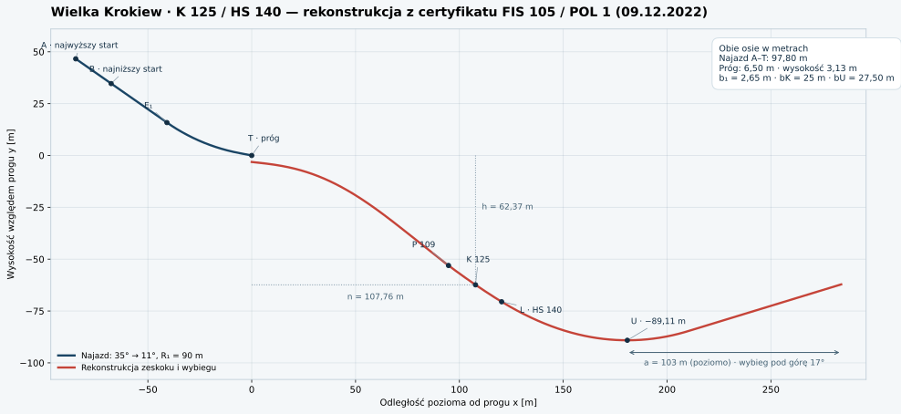

# SKYLIFT 3D — 0.11 / Milestone 1: narty i wiązania

Laboratorium najazdu i wybicia. Three.js + TypeScript + Vite; bez tekstur obrazkowych.

## Podgląd online: GitHub Pages

Workflow `.github/workflows/pages.yml` publikuje grę po każdym pushu do `main`, po instalacji z lockfile, testach fizyki i buildzie. Docelowy adres to `https://damwach.github.io/WDSJ/` (działa po udanym wdrożeniu).

Jednorazowe ustawienie repozytorium w GitHub: **Settings → Pages → Build and deployment → Source: GitHub Actions**. Jeśli pierwszy workflow zakończył się przed włączeniem Pages, otwórz **Actions → Publish SKYLIFT to GitHub Pages → Run workflow**, wybierając gałąź `main`.

`npm run build:pages` ustawia ścieżki zasobów na `/WDSJ/`. Zwykłe `npm run build` pozostaje dostępne do hostingu w katalogu głównym, np. Vercel (Build command: `npm run build`, Output directory: `dist`). Vercel wymaga osobnego podłączenia repozytorium do projektu.

Do pracy lokalnej: sklonuj repozytorium, wejdź do jego folderu, uruchom `npm ci` i `npm run dev`. Lokalny Codex może edytować i uruchamiać tę samą wersję. Przed wysłaniem zmian wykonaj build oraz odpowiednie testy.

## Uruchomienie bez instalacji

Podgląd online działa pod adresem https://damwach.github.io/WDSJ/?v=0.11. Kamera „Skocznia” pokazuje pełny profil Wielkiej Krokwi; „Pokaz techniki” i „Zawodnik” pokazują ruch z bliska.

Opcjonalnie pobierz `artifacts/SKYLIFT-0.11.html` na swój komputer i otwórz go w Chrome lub Edge. Plik zawiera cały kod, Three.js i style. Działa bez serwera, internetu i Node.js.

Adres `localhost` dotyczy komputera, na którym działa przeglądarka. Serwer uruchomiony w środowisku chmurowym nie jest dostępny przez `localhost` na Twoim komputerze.

## Uruchomienie dla programisty

Node.js 22+:

```sh
npm ci
npm run dev -- --port 5173
```

Uruchom te komendy w folderze projektu na swoim komputerze i otwórz adres podany przez Vite. Ścieżka `/workspace/WDSJ` dotyczy wyłącznie środowiska chmurowego.

Odtworzenie pojedynczego pliku HTML:

```sh
npm run build:standalone
```

Rozpocznij najazd lub wybierz pokaz techniki. W ostatnich 8 m przytrzymaj oba przyciski myszy i przesuń mysz w górę (około 120 px daje pełny cel wyprostu). Kierunek boczny przesuwa modelowaną linię reakcji, szybkość gestu zwiększa mimośród siły. R resetuje, spacja zatrzymuje symulację. Kamera boczna służy analizie ruchu.

## Kontrola jakości

```sh
npm run build
npm test
npm run build:standalone
npm run test:visual
```

Test używa systemowego /usr/bin/chromium (lub CHROMIUM_PATH). Obejmuje także zawartość pojedynczego HTML z wyłączonym dostępem do sieci. Polityka Chromium w chmurze blokuje nawigację `file://`, więc test osadza dokładną zawartość pliku na pustej stronie; otwarcie pliku na komputerze użytkownika wymaga przeglądarki dopuszczającej lokalne HTML.

Zrzuty kolejnych faz trafiają do artifacts/. Test przeglądarkowy sprawdza błędy konsoli, najazd–lot–lądowanie, długości kości, kadr oraz interpolację. Zapisuje też izolowane pozy zawodnika. To kontrola działania z zapisem obrazów, nie automatyczne porównanie z zatwierdzonym wzorcem. Testy Chromium są wykonywane kolejno ze względu na współdzielone zasoby programowego WebGL w chmurze.

## Zakres i ograniczenia

Wymiary zawodnika: udo 44 cm, podudzie 43 cm, tułów 53 cm, narty około 2.6 m. Od 0.8 skocznia ma wymiary Wielkiej Krokwi według przekazanego certyfikatu FIS 105 / POL 1: K 125 / HS 140. Jeden metr odpowiada jednej jednostce sceny. Certyfikat nie jest pełnym pomiarem profilu; brakujące równania i wymiary terenu są rekonstrukcją, opisaną w [HILL-HS140.md](docs/HILL-HS140.md). Certyfikacja rzeczywistego obiektu nie jest certyfikacją modelu gry.

Fizyka jest deterministyczna dla identycznych próbek na identycznych krokach. Wejście na żywo trafia do najbliższego kroku, bez pełnego systemu replayu. Przerwy klatek powyżej 250 ms są ograniczane. Rendering interpoluje prezentację między krokami 120 Hz, bez zmieniania stanu fizycznego.

Model sił używa pełnej grawitacji, prędkości względem wiatru oraz osobnych powierzchni aerodynamicznych ciała i nart. Napęd wyprostu ma ograniczone siły; moment wybicia wynika z mimośrodu reakcji. Lądowanie wynika z kontaktu nart z profilem i rozprasza normalną energię; po nim następuje wybieg. W locie ruch myszy w pionie zmienia sylwetkę, w bok balans; wiatr ustawisz pod przyciskiem „?”.

Współczynniki aerodynamiczne, bezwładność i parametry mięśni są oszacowaniami. Nie wykonano walidacji tunelowej ani motion capture. Opis równań, naprawionego błędu grawitacji i ograniczeń: [docs/PHYSICS.md](docs/PHYSICS.md).

Analiza poprzedniej wersji: [docs/REVIEW-v03.md](docs/REVIEW-v03.md).

## Zmiany wizualne 0.5

- Pełna panorama najazdu, progu, zakrzywionego zeskoku i płaskiego wybiegu. Kamera „Transmisja” śledzi zawodnika z boku i pokazuje teren przed nim; „Zawodnik” służy analizie pozy.
- Nowa sylwetka z modelowanym kombinezonem, twarzą, kaskiem/goglami, rękawicami, butami i profilowanymi nartami. Geometria pozostaje stała; ruch przebiega przez hierarchię stawów.
- Konstrukcja skoczni, schody, startowy pawilon, odległości, barierki, trybuny, las i łagodne górskie grzbiety. Elementy powtarzalne są renderowane instancjami.
- Kompaktowy HUD pozostawia środek ekranu grze. Widok pionowy ma osobny kadr i zasięg mgły.
- Zeskok ma ciągłą wysokość i styczną; fizyka kontaktu używa tej samej stycznej co geometria. To profil projektowy, bez certyfikacji FIS.

Referencja `skijumping.io` była niedostępna przez politykę sieci środowiska (CONNECT 403). Nie wykonano bezpośredniego porównania z jej grafiką. Sterowanie gestem obu przycisków, moment wybicia i stały krok 120 Hz zostały zachowane.

## Zmiany 0.6

Naprawa grawitacji dzielonej przez masę, fizyczny COM i napęd kontaktu, poprawiona szybkość gestu, ograniczone ramię reakcji, oddzielne powierzchnie ciała/nart i trójwymiarowy kierunek nośności, moment i tłumienie aerodynamiczne, przygotowanie do kontaktu/lądowanie/wybieg oraz bardziej anatomiczny kask, gogle i pozycja zawodnika. Próbny pokaz w spokojnym powietrzu: około 69 m, 3.3 s lotu, kontakt około 2.2 m/s. To wynik modelu, nie porównanie z pomiarem rzeczywistego skoku.

## Zmiany 0.7

- Pełniejszy model z gładkimi profilami kombinezonu, granatowymi nogawkami, anatomiczną twarzą, dopasowanym kaskiem, wąskimi goglami, rękawicami i geometrycznym numerem startowym. Elastyczne powierzchnie kolan i łokci zginają się wraz ze stawami. Brak tekstur obrazkowych.
- Wspólna definicja pozy dla szkieletu i obliczeń środka masy. Kolana zaczynają wyprost przed biodrami; tułów pozostaje pochylony przy wybiciu. Przeniesienie ciała do pozycji lotnej poprzedza otwarcie nart do V.
- Przygotowanie do kontaktu, ograniczony zasięgiem nóg rozkrok telemarkowy, ugięcie po kontakcie i spokojniejsze odzyskanie pozycji. Amortyzacja jest warstwą wizualną, nie zwalidowanym modelem podatności mięśni.
- Bliższa kamera zawodnika oraz śledzenie przesunięcia, które usuwa opóźnienie kadru przy dużej prędkości. Interpolacja klatek wygładza ruch pomiędzy krokami fizyki.
- Załączoną v0.3 uruchomiono w Chromium i porównano sylwetkę oraz sekwencję wyprostu. Zachowano jej czytelność ruchu, bez kopiowania zmieniających się długości kości.

Szczegóły porównania i ograniczeń animacji: [docs/ATHLETE-v07.md](docs/ATHLETE-v07.md).

## Wymiary skoczni 0.8

Najazd A–T 97.80 m, dolna belka B–T 77.00 m, nachylenie 35°, łuk R90 m, próg 6.50 m / 11°, wysokość progu nad śniegiem 3.13 m. Punkt K ma współrzędne (107.76, −62.37) m względem progu, a nie x=125. Szerokości: najazd 2.65 m, K 25.00 m, wybieg 27.50 m. Wyjście z zeskoku osiąga y=−89.11 m; wybieg ma 103 m rzutu poziomego i końcowe nachylenie pod górę 17°.

Rendering, pomiar odległości i kolizja współdzielą profil. P109, K125 i HS140 są liniami na odpowiednich odcinkach zeskoku. Start następuje z postoju na najwyższej belce, a prędkość wynika z grawitacji i oporów. `v0=28.28m/s` zapisane w certyfikacie jest wartością referencyjną, nie sztucznie wymuszoną prędkością.



Źródłowy [certyfikat PDF](docs/reference/HS140_2022.pdf), [dane profilu JSON](artifacts/hs140-profile.json) i [opis rekonstrukcji](docs/HILL-HS140.md) są w repozytorium. Dane można odtworzyć przez `node scripts/export-hill.mjs`; wykres przez `MPLCONFIGDIR=/tmp/skylift-mpl python3 scripts/plot-hill.py` (wymaga Matplotlib).

Zmniejszono powierzchnię referencyjną ciała do 0.489 m² na podstawie rzutu geometrii. Dodano przybliżenie małego wydłużenia powierzchni oraz zmieniono szacunkowy trym/tłumienie momentu. Te parametry nie pochodzą z certyfikatu i nie są walidacją aerodynamiczną. Pomiar geometrii: `npm run measure:body`. Pokaz używa gestu 500 px/s od ostatnich 6.5 m; gracz nadal steruje gestem obu przycisków. Automatyczne hamowanie na wybiegu pozostaje modelem zredukowanym.

## Tunel aerodynamiczny 0.9

Przycisk „Tunel aerodynamiczny” otwiera osobny podgląd tej samej funkcji sił co lot i wstrzymuje skok. Suwaki zmieniają prędkość przepływu, ustawienie nart, pochylenie tułowia, otwarcie V i gęstość. Można porównać pozycje A/B i wyeksportować krzywą do CSV. Wyniki są prognozami niezwalidowanego modelu, nie eksperymentem ani CFD.

Opis: [WIND-TUNNEL.md](docs/WIND-TUNNEL.md). Audyt fizyki i status dostępności danych naukowych: [AERODYNAMIC-AUDIT.md](docs/AERODYNAMIC-AUDIT.md). CI sprawdza także WebGL w Chromium; [CI.md](docs/CI.md) wyjaśnia zastąpienie błędnego workflow Deno.

## Milestone 1 — narty i wiązania

Każda narta ma własny stan, COM, bezwładność, kąt i siły aerodynamiczne. Przednie mocowanie jest przegubem, a pięta porusza się względem narty w granicach widocznego tylnego pręta. Sprężyny i tłumienie przenoszą równą i przeciwną reakcję na zawodnika. Domyślne 57% mierzy się do czubka buta: 1.482 m przed nim i 1.118 m za nim, wyświetlane 148 cm. Dokładnego zapisu dokumentu FIS nie zweryfikowano niezależnie; zastosowano regułę przekazaną w specyfikacji i konserwatywną walidację konkursową.

Prześwit co najmniej 3 cm wynika z geometrii nart i osiągalnego odwiedzenia nóg. Długości kości pozostają stałe. W tunelu wybierz **Wiązania**, aby obejrzeć mocowanie, piętę i metalowy ogranicznik; dwa suwaki są statycznym stanowiskiem laboratoryjnym. W skoku względne kąty nart wynikają z dynamiki. Tryb treningowy z naturalnym sterowaniem należy do późniejszego milestone’u.

Opis jednostek, parametrów i ograniczeń: [EQUIPMENT.md](docs/EQUIPMENT.md). Physics Studio, sterowanie kostkami, deterministyczne zaburzenia i nowa siatka człowieka pozostają oddzielnymi etapami. Rejestrator/replay z wcześniejszej specyfikacji jest w osobnym [PR #3](https://github.com/damwach/WDSJ/pull/3).
