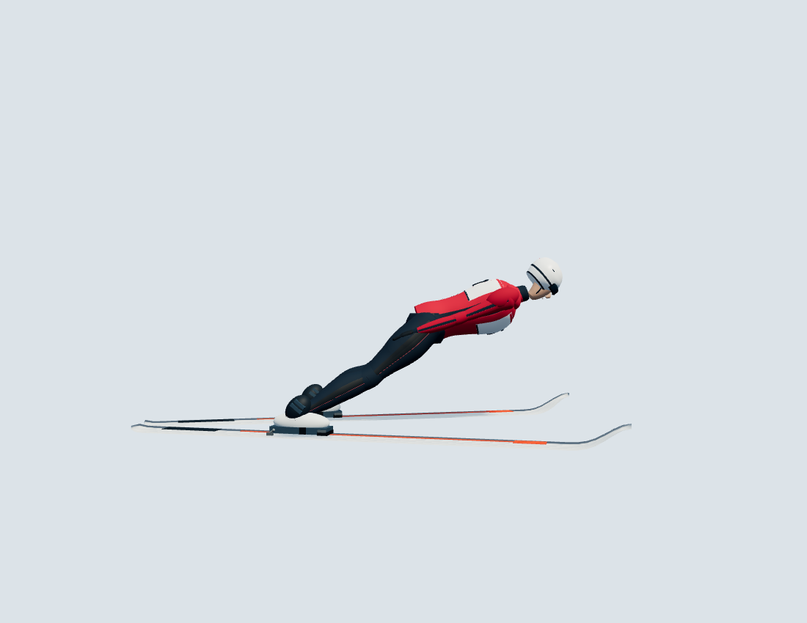
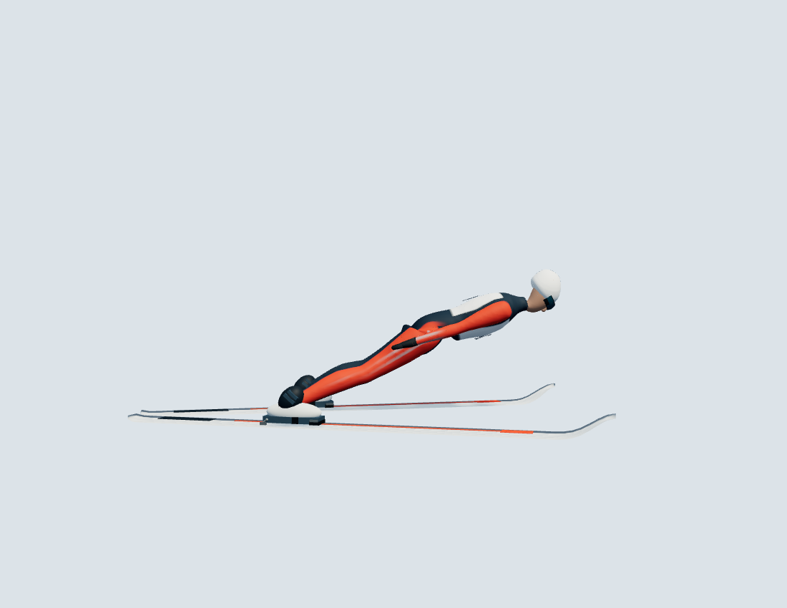
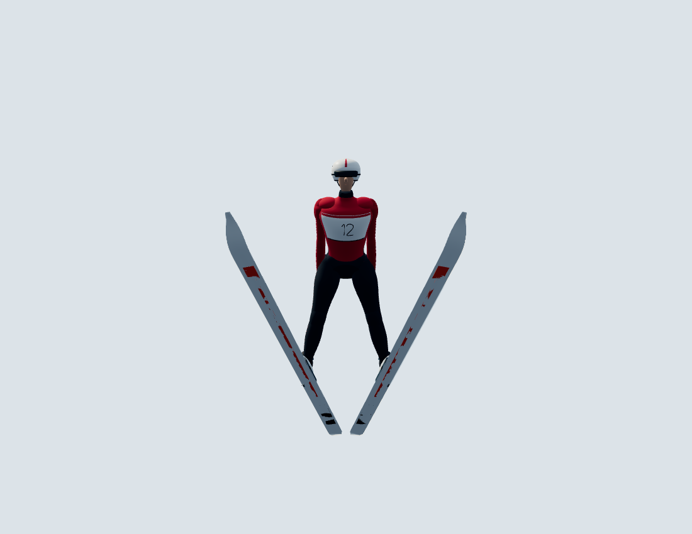
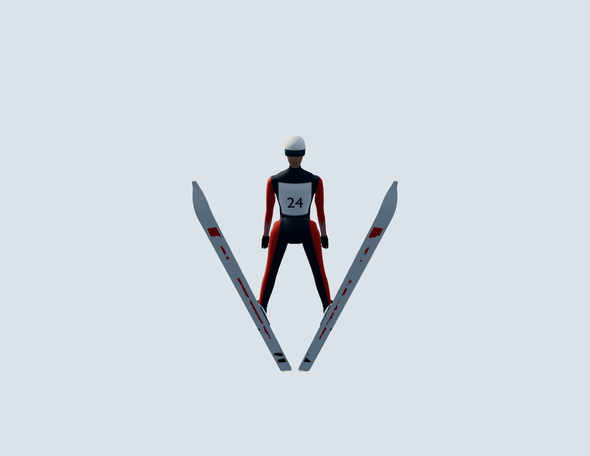

# GLB athlete review

The final athlete is loaded with Three.js GLTFLoader from a Blender-exported GLB. It is a new skinned asset, not the old procedural meshes packaged inside GLB. Old `human.ts` and `surfaces.ts` have been removed. The model contains one connected suit component (29,548 source vertices), 19 bones and no unweighted suit vertices. Including face/accessories, the asset has 65,792 triangles in 22 skinned meshes. A 1000-update browser sample measured about 0.094 ms CPU per pose update in this cloud environment; this is not a hardware FPS claim. GLB is approximately 2.2 MB; the offline build embeds it and needs no network.

## Visual inspection

Fifteen fixed-camera screenshots were taken **before and after** using real Chromium/WebGL, including neutral front/side/back/three-quarter, inrun, full extension, 0.2 s, 0.5 s, settled side/front/top, telemark and approximate reference directions. The original photos were inspected and remain unchanged; attribution/licences are in `references/athlete/README.md`.

[Review gallery](../artifacts/athlete-review/index.html) · [Before images](../artifacts/athlete-review/before) · [After images](../artifacts/athlete-review/after)

| Side before | Side after |
|---|---|
|  |  |

| Front before | Front after |
|---|---|
|  |  |

Inspection drove corrections to hip/arm weight separation, face/helmet normals, shoulder contours, neck extension, hand/thigh clearance, and the shared flight thigh/shin targets. The resulting side line has less hip bend and a continuous knee silhouette; front/top views retain symmetric V and separate tails. Landing arms spread and recover on the existing contact clock. Boots and rod anchors are still driven by the existing equipment solver. Facial features and the suit are deliberately stylised; these are not photorealistic portraits or calibrated reconstructions of the photographs.

## Physics comparison

Baseline: `2d2e4fb379df09547276ce45a5f1936ebcd825a2` (PR #7). The renderer-only replacement initially reproduced the sampled 2000-step run byte-for-byte. After correcting flight joint targets, the first 752 steps remain identical; first divergence is step 753, during flight. Both runs first land on step 1190. At that contact, root-datum x is 97.638636 m before and 97.603285 m after (difference −0.03535 m). Across 2000 steps, maximum absolute differences in root-datum x/y are 0.053851/0.183528 m and pitch 0.003287 rad; extension and roll are identical. Root datum is not COM position or measured jump distance.

Cause: the shared posture changes the segment-based COM offset and coupled response. This is intentional and documented; no artificial force/moment was added and no aerodynamic, equipment or contact coefficients were retuned. V clearance, front fixation and heel stops retain their existing tests. This controlled demo comparison is a regression check, not experimental biomechanics validation.

The final deformed mesh projects to 0.493773 m² at the default flight angle (1 mm raster; 2 mm: 0.493748 m²). The aerodynamic reference area remains 0.489 m²; this review does not silently recalibrate forces to the new mesh.

Raw before/after traces and [summary](../artifacts/athlete-review/physics-comparison.json) are included. `scripts/capture-athlete.mjs` reproduces them against `ATHLETE_REVIEW_URL`; it records x/y/pitch/roll/extension/phase and the complete ski-binding state for 2000 steps at 120 Hz.

## Checks

- TypeScript/Vite and standalone build: passed.
- Vitest: 108 tests passed, including GLB weights/normals, deformed finite positions, bone-to-joint alignment, animation transitions, deterministic flight and bindings.
- Blender connectivity audit: one suit component, 19 bones, zero unweighted suit vertices.
- Chromium/WebGL: all 17 tests passed (3.5 min), including offline HTML, real two-button input, landing, bindings and wind-tunnel views.

The first full browser run exposed stale bind-pose bounds in the wind-tunnel inspection/camera path. The application and its tests now measure deformed vertices. Source photos and `.blend` are not included in `dist`. The review branch is stacked on `feature/one-click-takeoff`; no Pages deployment or merge is part of this change.

The synthetic two-button browser test now advances explicit animation frames so software-renderer delays cannot move the skier beyond the takeoff table between assertions. The separate native mouse-button test still uses real browser scheduling.
